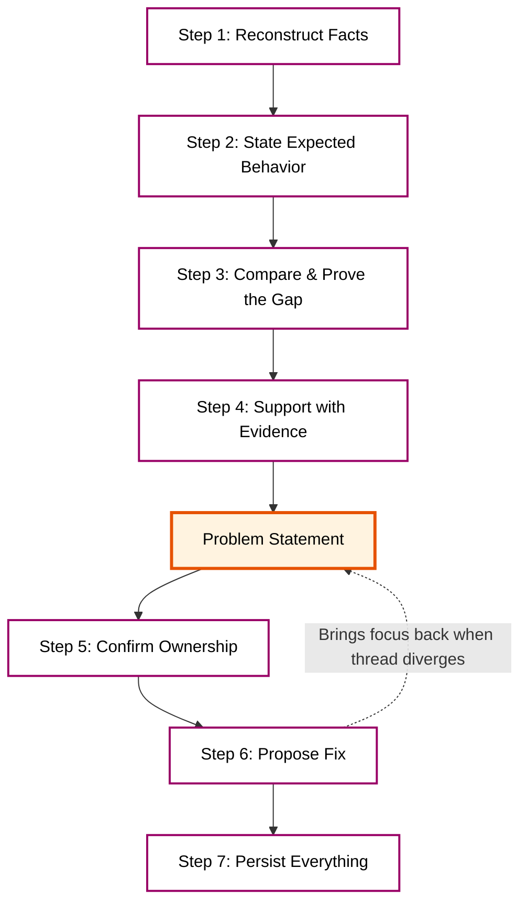

> The hardest part of solving a problem is proving it was understood correctly.

Slack threads that start with a vague complaint often spiral through five competing theories and end with someone merging a PR that "should fix it" — only for the issue to resurface three days later. Nobody made a mistake in bad faith. Everyone was just solving a different version of the problem.

Over time, I've developed a process that keeps me honest. It's not clever. It's not fast. But it works. I follow it every time I'm handed a problem that isn't mine, or a symptom that could mean ten different things.

In [a previous post](/posts/clarity-over-authority), I wrote about clarity as a leadership principle — the idea that seniority is about absorbing ambiguity and projecting clarity, not wielding authority. This post is the tactical follow-up: the actual steps I take to build that clarity when a problem is messy and the path forward isn't obvious.

The core idea is simple: **clarity is not a starting point — it's something built step by step, with evidence.**

---

## The Trap: Solving Before Understanding

Here's a pattern that keeps repeating:

1. Someone reports a problem in Slack.
2. Three people jump in with theories.
3. Someone starts debugging based on their theory.
4. They find something that _looks_ wrong and fix it.
5. The fix doesn't help — or makes things worse.
6. The thread forks into side conversations about related issues.
7. Nobody remembers what the original problem was.

The root cause of this chaos isn't poor communication or lack of skill. It's that **everyone skipped the part where the problem is proven.** They went straight from symptom to solution.

This post is about that missing middle part.

---

## Step 1: Reconstruct the Facts

Before forming an opinion, collect what happened. Not what _might_ have happened. Not what the error message _suggests_ happened. What **actually** happened, with timestamps and sources.

I write them down as plain sentences:

```
FACTS (reconstructed from logs, dashboards, user reports):
- 14:02 — User A reported "checkout page loads slowly"
- 14:03 — P95 latency for /api/checkout spiked from 200ms to 4800ms
- 14:05 — Error rate on payment-service jumped from 0.1% to 12%
- 14:07 — Deploy of payment-service v2.14.0 completed (started at 13:58)
- 14:10 — Rollback to v2.13.1 initiated
- 14:18 — Latency returned to normal after rollback
```

No interpretation. No "this means" or "probably because." Just what happened, in order, from sources that can be pointed to.

**Why this matters:** Facts are the shared ground. Everyone in the thread can agree on timestamps and log lines. Opinions are where people diverge. Start from the ground.

---

## Step 2: State the Expected Behavior — and Who Says So

This is the step most people skip, and it's the one that causes the most damage.

A problem can't be proven until "correct" is defined. And "correct" is not up to the person debugging — it's defined by the system's contract, the product spec, or the person who owns the domain.

I make this explicit:

```
EXPECTED BEHAVIOR:
- Checkout API should respond within 500ms at P95 (per our SLO)
- Payment processing should succeed for valid cards >99% of the time
- A deploy should not increase error rate by more than 0.5% (per deploy policy)

WHO DEFINES THIS:
- Latency SLO: defined by platform team, documented in runbook
- Success rate: defined by product spec for payment flow
- Deploy policy: defined by engineering lead, agreed in Q3 planning
```

**Why this matters:** Without an explicit expected state, every fix is a guess. Something that wasn't broken might get "improved," or something working as designed might get "fixed." The expected behavior is the reference line. Without it, there's no gap to measure.

Naming **who** defines it also prevents assumptions from filling in the blanks. The API might feel like it should respond in 100ms. But if the SLO says 500ms, that feeling doesn't matter yet.

---

## Step 3: Compare Expected with Actual — Prove the Gap

Now there are two things: what happened (Step 1) and what should have happened (Step 2). Put them side by side.

```
THE GAP:
- Expected: P95 latency < 500ms
- Actual:   P95 latency = 4800ms
- Gap:      9.6x over SLO — confirmed violation

- Expected: Error rate < 1%
- Actual:   Error rate = 12%
- Gap:      12x over threshold — confirmed violation

- Expected: Deploy should not increase error rate > 0.5%
- Actual:   Error rate increased by 11.9% within 4 minutes of deploy
- Gap:      23.8x over deploy policy limit — confirmed regression
```

This is where the problem stops being a feeling and becomes a **measurable, agreed-upon fact.** It's no longer "something seems off." It's "the system violated its contract by this much, at this time, in this way."

**Why this matters:** A proven gap is impossible to argue with. It's not a theory. It's the distance between the documented expectation and the observed reality. Everyone in the Slack thread can look at the same numbers and agree: yes, there is a problem here.

---

## Step 4: Support the Gap with Evidence — Logs, Data, and Code

A gap statement is strong. A gap statement backed by evidence is unassailable.

This is where the receipts come in:

```
EVIDENCE:

1. LOGS — payment-service logs show new validation step added in v2.14.0
   calling external fraud-check API synchronously on every request.
   (log line: "fraud_check: timeout after 3000ms" — 847 occurrences in 5 min)

2. DATA — Grafana dashboard shows latency correlation with deploy timestamp.
   Spike begins at 14:03, exactly when v2.14.0 started serving traffic.
   No other deploys or config changes in the window.

3. CODE — Diff between v2.13.1 and v2.14.0 shows:
   + const fraudResult = await fraudCheckService.validate(order);
   This call was not present in v2.13.1. It has no timeout or fallback.
```

Three types of evidence, three angles of proof:

- **Logs** show what the system was doing at the moment of failure.
- **Data** shows the pattern and correlation over time.
- **Code** shows the mechanism — the specific change that caused the behavior.

**Why this matters:** Evidence turns "I think the deploy caused it" into "here is the exact line of code, here is the log showing it timing out, and here is the graph showing the correlation." The move is from opinion to demonstration.

---

## Step 5: Confirm Ownership

Now the picture is clear: what happened, what should have happened, how big the gap is, and what caused it. Before fixing anything — **who owns this?**

```
OWNERSHIP:
- payment-service: owned by @payments-team (primary: @alice)
- fraud-check integration: introduced by @bob in PR #1847
- SLO monitoring: owned by @platform-team
- Incident coordination: @alice (on-call this week)
```

This isn't about blame. It's about **who has the context, authority, and access to make the right decision.** The person who owns the service knows its history, its constraints, and its trade-offs. The person who wrote the code knows the intent. The on-call engineer knows the current incident state.

**Why this matters:** Fixing someone else's system without their context might solve the symptom but break an invariant. Ownership ensures the fix is made by someone who understands the full picture — or at least consulted first.

---

## Step 6: Only Then — Propose or Implement a Fix

Everything before this step was investigation. This is where action begins.

But notice: the fix comes **last.** Not first. Not second. After a complete, evidence-backed picture of the problem has been built.

```
PROPOSED FIX:
- Add timeout (500ms) and fallback (allow transaction) to fraud-check call
- Move fraud-check to async post-payment flow (non-blocking)
- Add circuit breaker for external fraud-check API

RATIONALE:
- Root cause: synchronous external call with no timeout or fallback
- Fix addresses the mechanism (Step 4, Evidence #3)
- Expected outcome: latency returns to < 500ms P95 (closes the gap in Step 3)

RISK:
- Fallback allows potentially fraudulent transactions through
- Mitigation: queue for async fraud review, flag for manual check
- Decision needed from @product: acceptable fraud risk during fallback?
```

Notice the structure: the fix references the evidence, references the gap, and states what risk it introduces. It doesn't just say "add a timeout." It says **why** this fix closes **this** gap, and **what** it might break.

**Why this matters:** A fix without context is a liability. Four steps of investigation just happened — the fix should be proportional to that evidence, not to confidence.

---

## Step 7: Persist Everything — Evidence, Decision, and Open Questions

The Slack thread will move on. People will forget. The next person hitting this problem will start from zero — unless it's written down.

After the incident, I create a short document:

```
INCIDENT SUMMARY:
- What: Checkout latency spike (4800ms P95) caused by v2.14.0 deploy
- When: 2026-10-11, 14:02–14:18 UTC+8
- Impact: 12% error rate on payment flow for 16 minutes
- Root cause: Synchronous fraud-check call with no timeout (PR #1847)
- Fix: Added timeout + fallback, moved to async flow
- Decision: Accepted brief fraud-risk increase during fallback (approved by @product)

OPEN QUESTIONS:
- Should fraud-check have its own SLO separate from checkout latency?
- Do we need a deploy canary that catches latency regressions before full rollout?
- Are there other external calls in payment-service without timeouts?

EVIDENCE LINKS:
- Grafana dashboard: [link]
- Log search: [link]
- PR diff: [link]
```

**Why this matters:** This is how organizational memory works. Without it, the same problem happens again in six months with a different team, and everyone goes through the same investigation from scratch. The document is cheap. The repeated incident is expensive.

---

## The North Star: The Problem Statement

Here's the meta-principle behind all seven steps: **write down the problem statement before doing anything else.**

```
PROBLEM STATEMENT:
"After deploying payment-service v2.14.0 at 14:02, checkout API P95 latency
increased from 200ms to 4800ms and error rate jumped from 0.1% to 12%.
The cause is a new synchronous fraud-check call without timeout or fallback."
```

One paragraph. Specific. Measurable. Contains the what, when, where, and why.

This is the north star. When the Slack thread starts drifting — when someone brings up a related but different issue, when someone proposes a fix for a problem that hasn't been proven, when the conversation forks into architecture debates — come back to this statement.

> "That's an important topic, but it's not the problem being solved right now. The problem is: [problem statement]. Does what you're suggesting close this gap?"

This is not dismissive. It's respectful. It tells people their input is valued but keeps the team focused on the thing that's actually broken. Without a north star, every interesting tangent becomes the priority, and the actual problem waits another day.



---

## When to Use This (and When Not To)

This process is for problems that are:

- **Ambiguous** — the symptom could mean multiple things
- **Cross-team** — nobody has full context alone
- **High-stakes** — a wrong fix could make things worse
- **Recurring** — this type of problem will be faced again

It's overkill for:

- **Obvious bugs** — typo in a config file, just fix it
- **Solo debugging** — the whole system is owned by one person, iteration is fast
- **Exploratory work** — prototyping, not incident-responding

The sign that this process is needed: a Slack thread where nobody can agree on what the problem is. That's the moment to stop, go back to Step 1, and build clarity from the ground up.

---

## The Real Insight

The insight isn't the seven steps. Anyone can follow a checklist.

The insight is that **clarity is an artifact that gets constructed, not a state that exists at the start.** Clarity doesn't come first, followed by investigation. Investigation comes first, and clarity emerges from the evidence gathered, the gaps measured, and the problem statement written.

And once it's there — once the problem can be stated in one paragraph, with numbers, with evidence, with a named owner — everything else gets easier. The fix becomes obvious. The conversation converges. The Slack thread resolves instead of spiraling.

The hardest part of solving a problem isn't the solution. It's making sure everyone agrees on what the problem is.

---

## Practical Next Steps

To try this out:

1. **Next time entering a chaotic Slack thread**, don't propose a fix. Write down the facts first. Just the facts.
2. **Ask one question**: "What should the system be doing?" Write down the expected behavior and who defined it.
3. **State the gap** in numbers. Not "it's slow" — "P95 latency is 9.6x over SLO."
4. **Write the problem statement** in one paragraph. Share it in the thread. Ask: "Is this the problem being solved?"
5. **After the incident**, write the three-line summary: what happened, what fixed it, what's still open.

All seven steps aren't needed every time. Start with the first three. The habit of stating facts before opinions is where the leverage is.
