First post of a series on trance arrangement phrases — Intro, Build, Breakdown, Drop, Outro — one per post, same rule every time: concrete structure and numbers, no "this section feels magical" hand-waving.

Starting with the **breakdown**: it's the phrase people associate most with trance, and the one producers get wrong most often. And yes — this is the *Breakdown* breakdown. The pun writes itself, so we're getting it out of the way in paragraph two.

## What

The breakdown is the phrase where **the drums and bass stop** — and the harmonic and melodic content carries the track alone. The test is mechanical:

> **If you mute everything below ~150 Hz and the section still works, it's a breakdown. If it collapses, it isn't.**

| Element     | State during breakdown                              |
|-------------|-----------------------------------------------------|
| Kick        | Removed entirely                                    |
| Bassline    | Removed                                             |
| Hats/claps  | Removed, or filtered into the background            |
| Pads        | Full sustain, often the loudest they'll ever be     |
| Lead melody | Stated clearly — usually the first "clean" statement of the main theme |
| Riser/FX    | Ramping up, feeding into the build                  |

Two things it is *not*:

- **The drop** — opposite energy arrows. Energy goes *down* into a breakdown and the *build* lifts you out; energy goes *up* into a drop and the beat slams back in. Breakdown → build → drop, in that order. (We say **drop** — the term every DJ and producer actually uses; older encyclopedic sources call it the "climax", but nobody says that on the floor.)
- **A filtered groove section** — if the kick is still there but low-passed, that's a mini-breakdown in progress. The real one drops the low end completely.

## Why

**1. Contrast economics.** Perceived impact is proportional to the *change* in energy, not absolute energy. A track at full intensity for six minutes has no dynamics — the breakdown is the subtraction that makes the next addition register as a peak.

**2. The DJ mixing window.** Breakdowns are where DJs beatmatch and blend the next record — a 32-bar breakdown at 138 BPM is about **28 seconds** of kick-free space. Too short to mix over makes a track useless behind the decks, no matter how good the drop is.

**3. Genre identity.** The long melodic breakdown is what separates trance from techno and progressive house, which keep the drums running. Remove it and what's left is a techno track with more reverb.

## How

**Exit the drums at a phrase boundary** — the end of an 8- or 16-bar block. Three ways: a hard cut, a filter-out over 2–4 bars, or a 1-bar fill. Pick one per track; stacking all three is over-signaling.

**What stays: pads and the theme.** With the rhythm section gone, pads sustain the harmony and the lead gets its clearest statement — often the theme "naked", before the full arrangement slams it in the drop. (The breakdown melody can also be a subdued motif that the drop answers with an aggressive supersaw version — just don't introduce a completely unrelated theme. That's a second song.)

**What builds: the rebuild kit**, layered in roughly this order — a long filtered-noise riser spanning the whole phrase, a sharper riser over the final 4 bars, a snare/clap roll with tightening subdivisions, a low-pass filter on the pads sweeping up from ~400–800 Hz to open, and hi-hats re-entering 8 bars before the drop lands.

Mapped out as a DAW tracks view — one lane per instrument, axis in bars — a 32-bar breakdown at 138 BPM (~56 seconds) looks like this:

```mermaid
%%{init: { "theme": "default", "gantt": { "barHeight": 26, "barGap": 6, "topPadding": 60, "leftPadding": 200, "fontSize": 13 } } }%%
gantt
    title 32-bar breakdown anatomy · 138 BPM · ≈56 s · axis = bars
    dateFormat x
    axisFormat %Q
    tickInterval 4millisecond
    section Kick + bass
    Exit at bar 0 :milestone, k0, 0, 0
    Out :done, k1, 0, 31
    section Pads + theme
    Full sustain · filter sweeps open :active, 0, 31
    Near-silence dip :done, 31, 32
    section Risers
    Long filtered-noise riser :active, 0, 28
    Sharp riser · filter fully open :active, 28, 32
    section Roll + hats
    Snare roll · quarters → sixteenths :active, 24, 32
    Hi-hats re-enter :active, 24, 32
    section Markers
    Drop — full arrangement :milestone, mD, 32, 32
```

Read it top-down like a tracks view: the kick + bass lane goes out at bar 0 and stays out — that gray emptiness is what every other lane fills. The build is everything stacking between bar 0 and the drop marker.

**Engineering that does real work:**

- **Long reverb finally pays off.** Everywhere else in the track, drum transients mask reverb tails — with the drums gone, 2–4 second hall/plate tails become clearly audible. This is the phrase to use them.
- **Keep the low end empty.** High-pass the pads around 100–150 Hz so no sub content muddies the bass when it re-enters — the cleaner the silence below ~150 Hz, the harder the drop hits.
- **Steal a beat of silence.** Dip the pad volume a bar before the drop, or cut everything but the riser for a half-bar — near-silence right before impact makes the impact larger. Once per track; doing it every 8 bars is a gimmick.

**Length is arithmetic.** 16 bars is the functional minimum for a main breakdown, 32 is the classic uplifting default:

| Tempo | 1 bar   | 16 bars | 32 bars |
|-------|---------|---------|---------|
| 128   | 1.88 s  | 30 s    | 60 s    |
| 138   | 1.74 s  | 28 s    | 56 s    |
| 140   | 1.71 s  | 27 s    | 55 s    |

If your idea can't sustain 16 bars, it's too thin — add a harmonic movement, don't loop two bars four times and call it an arrangement.

## When

To place the breakdown you need the skeleton around it. The standard extended-mix shape at 138 BPM puts **two drops on either side of it**: the theme's own (lighter) drop before it, the main one after the build.

| Section              | Bars   | Approx. time | Notes |
|----------------------|--------|--------------|-------|
| Intro                | 16–32  | 0:00 – 0:55  | DJ mix-in point; sparse drums |
| Theme 1 + first drop | 16–32  | 0:55 – 1:50  | Often introduces the motif in a sliced-up, simplified form — a "taste" of what comes after the breakdown (Snoman) |
| **Breakdown**        | 16–32  | 1:50 – 2:45  | DJ mixing window; drums and bass out |
| Build                | 8–16   | 2:45 – 3:10  | Riser, roll, filter; drums re-enter. 8–16 is typical — a 32-bar build would outgrow most breakdowns |
| Main drop            | 32     | 3:10 – 4:05  | The payoff — fullest arrangement. The breakdown exists to make this land |
| Outro                | 16–32  | 4:05 – 5:30  | DJ mix-out point; the arrangement strips back down |

The breakdown lands roughly **a third of the way in**, after the first full-energy phrase, with everything after it as the payoff. A minority of longer and psy-influenced tracks run a double-breakdown variant — main drop → short second breakdown → third drop — but two drops is the default.

- **One main breakdown per track.** If you add a second one, make it shorter and simpler — feeding the next drop, not competing with the first.
- **It must precede your biggest moment.** If the drop is weaker than the breakdown promised, the listener experiences that as a bug.
- **When DJing, it's your in-point.** Be fully blended before your track's own breakdown hits, so the dancefloor gets one continuous trough-and-peak across two records.
- **DJ tools and peak-time tracks may shorten it.** A *peak-time* track is one built for the highest-energy hours of a set — stripped-down, mix-efficient, not made for deep listening. For those, 8–16 bars of mostly riser and FX is an honest choice. Just make it deliberate.

## Recap

- **What**: drums and bass out, pads and theme in. The 150 Hz test.
- **Why**: contrast, the DJ mixing window, genre identity.
- **How**: exit at a phrase boundary → pads + theme → riser, roll, filter, drum re-entry → 16–32 bars.
- **When**: a third of the way in, once, before the biggest drop.

Next in the series: the **build** — 8–16 bars that decide whether your drop lands or limps.
