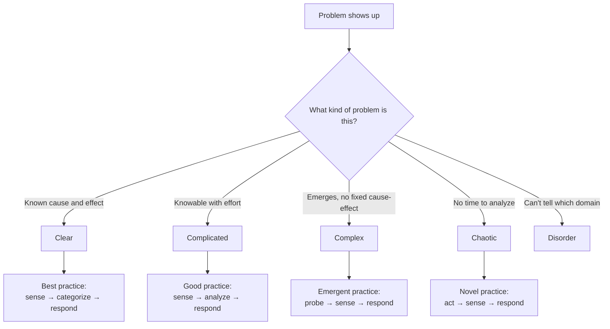
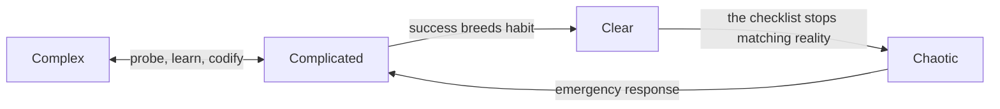

## The Bug That Taught Me Nothing

A few months ago I fixed a flaky test by pinning a dependency version. It worked. I wrote it up, felt smart, moved on.

Two weeks later, a different flaky test showed up. I pinned the version again. It got worse.

That was the moment I realized I was using one playbook for two completely different kinds of problems. The first was a puzzle with a known answer. The second was a living system that reacted to my moves. Same reaction, wrong domain.

The Cynefin framework is the map I wish I'd had before that second bug. It's a sense-making model from Dave Snowden — the name is Welsh, roughly meaning "habitat" or "place of multiple belongings" — and its core claim is simple: **different problems need different decision-making methods, and most mistakes come from using the method of one domain on a problem from another.**

## The Five Domains

Cynefin sorts situations into four named domains plus a fifth catch-all:

Let me walk through each one with situations I've actually been in.

### Clear: The Domain of Checklists

Cause and effect are obvious to anyone who looks. Deploy broke because the config file is missing? Fix the config, write a runbook so nobody has to think about it again.

The trap here isn't difficulty — it's complacency. Clear-domain problems tempt me into autopilot, and when the world shifts underneath (a library changes its defaults), autopilot keeps executing a rule that no longer holds. Snowden calls the failure mode "entrained thinking." The antidote is simple: audit the checklist occasionally and retire rules that outlived their reason.

### Complicated: The Domain of Experts

Cause and effect exist, but they're not visible without analysis. This is most of classic engineering: performance tuning, database schema design, migrating a service. A competent expert can, with enough analysis, find the right answer.

The right move here is **good practice** — sense the situation, analyze it, then respond. This is where I hire specialists, write RFCs, and do root-cause analysis. It's also where I've wasted the most time: I once spent three days analyzing a load-balancing choice that, in hindsight, any reasonable option would have survived. Analysis has value, but it has a cost, and in other domains that cost buys nothing.

### Complex: The Domain of Experiments

This is the one that rewired how I think. In complex systems, cause and effect can only be seen **in hindsight** — the system is a network of interacting parts (people, teams, markets, codebases) where outcomes emerge rather than follow from causes.

Flaky tests in a big monolith. Team morale. Which feature will users adopt. Why did this release break production when the same change passed staging last month.

The move here is not analysis — there's nothing stable to analyze. It's **probe → sense → respond**: run safe-to-fail experiments, watch what happens, amplify what works, dampen what doesn't. A/B tests, feature flags, prototypes, "let's try it for one sprint" — these aren't sloppy substitutes for planning. They're the *correct* method for this domain, and planning harder is the incorrect one.

The dangerous failure mode is the reverse: applying complex-domain practices to complicated problems ("let's just try three architectures and see") or complicated practices to complex ones ("let's have an expert write a 40-page plan for how users will behave"). I've done both. The second one is the more expensive mistake.

### Chaotic: The Domain of Action

Something is on fire. The database is down, prod is throwing 500s, and customers are tweeting. There is no time to analyze and no value in probing.

The move is **act → sense → respond**: stabilize first, figure out what happened second. Assign clear ownership, take decisive steps, restore order. Only after the bleeding stops do I stop and ask which domain I was actually in — because chaos is usually a complex or complicated situation that got ignored until it tipped over.

### Disorder: The Trap in the Middle

The fifth domain isn't on the map as a territory — it's the state of not knowing which domain I'm in. This is, honestly, my default state most mornings. The framework's practical value starts with naming that confusion, because the *only* exit is to break the problem into pieces and sort each piece into a domain.

## The Complacency Loop

One more thing Snowden emphasizes that changed how I use the map: domains aren't fixed properties of problems. They drift.

A successful team moves work from complex to complicated to clear: experiments become analyses become runbooks. That's healthy — it's called efficiency. But every move toward the right erodes the ability to detect change. The runbook that worked for years keeps being followed after the world moved, and one day the clear domain collapses straight into chaos.

The fix isn't to avoid standardization. It's to keep a deliberate channel for probing — small experiments, slack time, people whose job includes noticing when the map stops matching the terrain.

## How I Use It Day to Day

I keep the five domains as a quick self-check before committing to an approach:

1. **Can I see the cause and effect right now?** → Clear. Write the checklist, follow it, schedule an audit.
2. **Could analysis find the answer, even if it takes effort?** → Complicated. Get the right people, analyze, decide. Don't drag it out.
3. **Can the answer only be known in hindsight?** → Complex. Design cheap, safe-to-fail probes. Decide by observation, not debate.
4. **Is there no time for any of the above?** → Chaotic. Act now, stabilize, reflect later.
5. **Can't tell?** → Disorder. Split the problem and sort the pieces.

The most useful question turned out to be #3. When I catch myself in a meeting debating which option is "right" for something users will decide by voting with their feet, I try to reframe: instead of *which is correct*, ask *what's the cheapest experiment that would teach us*.

## Practical Next Steps

- Pick one decision you're stuck on right now and sort it into a domain. Notice which playbook you were about to use.
- If it's complex, replace the plan with a probe: what's the smallest experiment that fails safely?
- Audit your team's checklists once a quarter. Clear-domain rules rot silently.
- Read Dave Snowden's original HBR article, *A Leader's Framework for Decision Making* (2007), and the Cognitive Edge / Cynefin Co materials for the full model — my summary flattens a framework that's deliberately richer than four quadrants.

The map doesn't make decisions for me. It just stops me from bringing a spreadsheet to a fire — or a fire hose to a spreadsheet.
